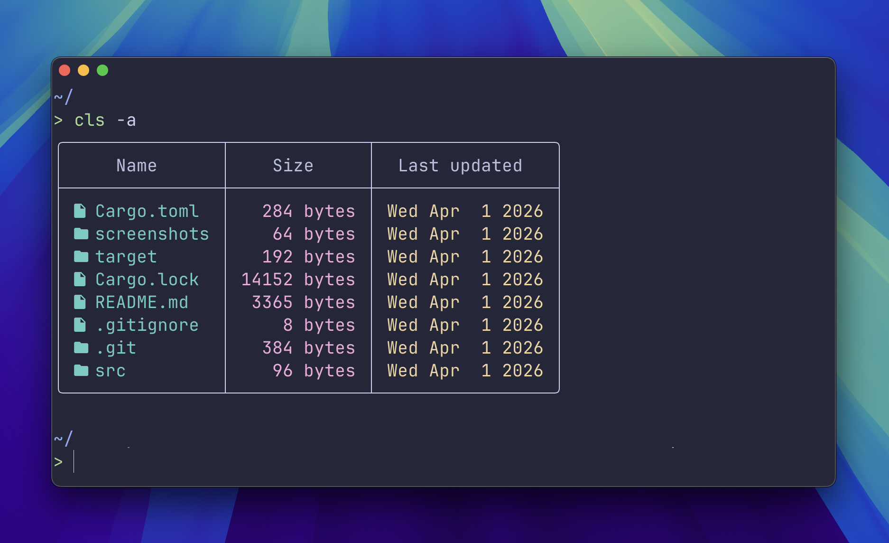

# cool-ls

A cooler, more colorful alternative to the classic `ls` command. Built with Rust for speed and reliability.



## Features

- 🎨 **Colorful output** - Color-coded columns for better readability
- 📊 **Table formatting** - Clean, organized table layout with rounded borders
- 🔤 **Nerd Font icons** - File and folder icons for visual distinction
- 📏 **File information** - Display file size and last modified date
- 👻 **Hidden files support** - Show hidden files with `-a` flag
- ⚡ **Fast** - Written in Rust for blazing fast performance

## Prerequisites

- **Rust** 1.75.0 or higher (install from [rustup.rs](https://rustup.rs))
- A terminal with **Nerd Font** support for proper icon display (recommended fonts: [JetBrains Mono Nerd Font](https://www.nerdfonts.com/), [Fira Code Nerd Font](https://www.nerdfonts.com/))

## Installation

### From Source

1. Clone the repository:
```bash
git clone https://github.com/yourusername/cool-ls.git
cd cool-ls
```

2. Build the project:
```bash
cargo build --release
```

3. Install the binary:
```bash
cargo install --path .
```

The binary will be installed to `~/.cargo/bin/cool-ls`. Make sure `~/.cargo/bin` is in your PATH.

## Usage

### Basic usage

List files in the current directory:
```bash
cool-ls
```

List files in a specific directory:
```bash
cool-ls /path/to/directory
```

### Show hidden files

Include hidden files (those starting with `.`):
```bash
cool-ls -a
```

Or with a specific path:
```bash
cool-ls -a /path/to/directory
```

### Command-line options

```
Usage: cool-ls [OPTIONS] [PATH]

Arguments:
  [PATH]  Directory path to list (defaults to current directory)

Options:
  -a              Show hidden files
  -h, --help      Print help
  -V, --version   Print version
```

## Building from Source

### Debug build
```bash
cargo build
```

The binary will be available at `target/debug/cool-ls`.

### Release build (optimized)
```bash
cargo build --release
```

The binary will be available at `target/release/cool-ls`.

### Run without installing
```bash
cargo run -- /path/to/directory
cargo run -- -a  # with flags
```
## Dependencies

- [clap](https://github.com/clap-rs/clap) - Command-line argument parsing
- [owo-colors](https://github.com/jam1garner/owo-colors) - Terminal colors
- [tabled](https://github.com/zhiburt/tabled) - Table formatting
- [chrono](https://github.com/chronotope/chrono) - Date and time handling
- [nerd-font-symbols](https://github.com/Shnatsel/nerd-font-symbols) - Nerd Font icons
